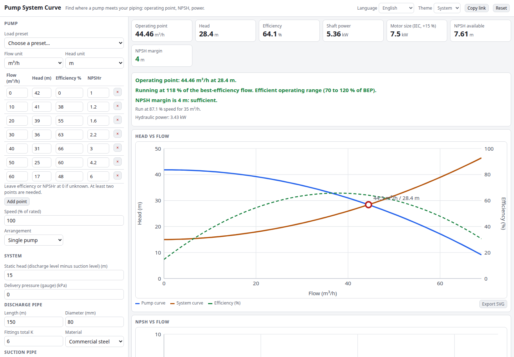

# Pump System Curve

Pump sizing with system curves. Enter a pump curve (or load a preset), describe the piping (static head, discharge and suction lines) and see where the pump actually operates: flow, head, efficiency, shaft power, motor size and NPSH margin. Try series or parallel pumps, change the speed with the affinity laws, and find the speed that delivers a target flow.

**Try it: [hermes98761234.github.io/pump-system-curve](https://hermes98761234.github.io/pump-system-curve/)**

[](https://github.com/hermes98761234/pump-system-curve/actions/workflows/deploy.yml)



## Features

- **System curve** = static head + delivery pressure + Darcy-Weisbach friction (Colebrook-White) and fitting losses in the discharge and suction lines.
- **Pump curve** from a table of points (flow, head, efficiency, NPSHr) with quadratic least-squares fits, plus three presets.
- **Operating point** by bisection, with efficiency, hydraulic and shaft power, next IEC motor size and a best-efficiency-point check (70 to 120 %).
- **NPSH available** from barometric pressure at altitude, water vapour pressure, suction head and suction friction, compared with NPSH required.
- **Series and parallel** pumps (identical units), and **affinity laws** for speed: Q ∝ N, H ∝ N², P ∝ N³, plus the speed needed for a target flow.
- Flow in m³/h, L/s or gpm; head in m or ft. CSV, JSON and SVG export, print, share link, English and Ukrainian, light and dark. Everything runs in the browser.

## How it works

The pump head is fitted as H(Q) = a + bQ + cQ². At speed ratio r the curve becomes r²·H(Q/r); n pumps in series give n·H(Q) and in parallel H(Q/n). The operating point is where this meets the system curve. Power is ρgQH/η. The model assumes water, identical pumps and curves that are accurate only inside the range of the entered points (the app warns when it extrapolates).

## Quick start

You need [Node.js](https://nodejs.org/) 22.

```bash
git clone https://github.com/hermes98761234/pump-system-curve.git
cd pump-system-curve
npm install
npm run dev       # http://localhost:5173
npm test          # unit tests
npm run build     # static site in dist/
```

## License

MIT
